# Yeelight Cube for Home Assistant (Cube Lite and Cube Matrix)

<table>
  <tr>
    <td align="center"><br><b>Cube Lite</b></td>
    <td align="center"><br><b>Cube Matrix</b> (<a href="#cube-matrix">what differs</a>)</td>
  </tr>
</table>

A Home Assistant custom integration for two Yeelight Cube lamps:

- the **Yeelight Cube Smart Lamp Lite**, a lamp with a **20×5 RGB LED matrix** (100 individually addressable pixels);
- the **Yeelight Cube Matrix** (the original Yeelight Cube), a base and a chain of **1 to 8 modules** in any order:
  **Matrix** (5×5 pixels), **Panel** (5×5, diffused) and **Spot** (one light).

Get full pixel-level control from your HA dashboard on either lamp: draw pixel art, display scrolling text, show the
clock, play effects, apply gradients, palettes and color effects, and more. Every card works with both.

[![Home Assistant][ha_badge]][ha_link] [![HACS][hacs_badge]][hacs_link] [![GitHub Release][release_badge]][release] [![Buy Me a Coffee][bmac_badge]][bmac]

## See what you can build

[](#lovelace-cards)

[Clock](#clock-card) / [Native effects](#native-effects-card) / [Pixel art](#draw-card)

<details>
<summary>See preview, gradient and palette controls</summary>

[](#lovelace-cards)

[Preview](#preview-card) / [Gradients](#gradient-card) / [Palettes](#palettes-card) / [Colors](#colors-card)

</details>

These overviews use generated screenshots of the actual cards with example data.
[Install with HACS](#installation-via-hacs), then [add your lamp](#setup).

---

## Table of Contents

**[`Cards at a glance`](#see-what-you-can-build)** · **[`Features`](#features)** · **[`Cube Matrix`](#cube-matrix)** · **[`Installation`](#installation-via-hacs)** · **[`Setup`](#setup)** · **[`Matter & buttons (optional)`](#matter-optional)** · **[`Lovelace Cards`](#lovelace-cards)** · **[`Entities`](#entities-created)** · **[`Automations`](#automations--node-red)** · **[`Display Modes`](#display-modes)** · **[`Requirements`](#requirements)** · **[`Devices`](#supported-devices)** · **[`Limitations`](#known-limitations)** · **[`Power Supply`](#power-supply)** · **[`Troubleshooting`](#troubleshooting)** · **[`License`](#license)**

---

## Features

| What you can do | Where to start |
| :-- | :-- |
| Display a clock with time/date styles, colours and favourites | [Clock Card](#clock-card) |
| Play native animations | [Native Effects Card](#native-effects-card) |
| React to room sound with the lamp's microphone | [Music Flow: use the device's select controls](#music-flow) |
| Draw pixel art or choose from 68 bundled official drawings | [Draw Card](#draw-card) |
| Show scrolling text, palettes and gradients | [Colors](#colors-card) / [Palettes](#palettes-card) / [Gradient](#gradient-card) |
| Preview the lamp live and adjust its brightness and colors | [Preview Card](#preview-card) |
| Use the lamp's buttons in automations and restore the display after a press | [Matter and buttons (optional)](docs/MATTER.md) |
| Drive a Cube Matrix of 1 to 8 modules (Matrix, Panel, Spot) and set its modules from the Preview card | [Cube Matrix](#cube-matrix) / [Modules section](#matrix-modules) |
| Keep control local, with automatic network discovery and no cloud dependency | [Setup](#setup) |

All seven cards have visual editors, light/dark themes and configurable layouts.
Normal display controls use **LAN Control**; **Matter is an optional extra**.

<a id="cube-matrix"></a>

### Using a Cube Matrix

Everything in this README works on a **Yeelight Cube Matrix** too (the original Yeelight Cube, LAN model
`CubeMatrix`): every card, service and entity, on every module of its chain. Three things differ:

1. **Tell the integration which modules are fitted.** Matrix, Panel and Spot, in chain order from the base, in the
   Preview card's [Modules section](#matrix-modules). The previews and cameras then draw each module as it looks.
2. **Share it to Home Assistant's Matter integration.** Optional on a Cube Lite, needed on a Cube Matrix, which has
   no LAN command for its effects, clock or drawings. With Matter it runs its own 50 effects and clock, and what Home
   Assistant draws is streamed at 25 frames a second; without it, everything is streamed over the LAN at about 5.
   See [Matter setup](#matter-optional).
3. **No microphone**, so no microphone effects or Music Flow.

The full guide, with a side-by-side comparison of the two lamps: **[docs/CUBE_MATRIX.md](docs/CUBE_MATRIX.md)**.

---

## Installation via HACS

### HACS (Recommended)

<div align="left">
  <a href="https://my.home-assistant.io/redirect/hacs_repository/?owner=Max-src&repository=yeelight-cube-ha" target="_blank" rel="noopener noreferrer">
    
  </a>
</div>

Or search for it in HACS:

<details>
<summary>Step-by-step HACS installation</summary>

1. Open **HACS** in your Home Assistant dashboard
2. Search for **Yeelight Cube** and open the result
3. Click **Download** (or **Install**) and confirm
4. **Restart Home Assistant**

</details>

<details>
<summary>Manual installation, updates and removal</summary>

### Manual Installation

1. Download the [latest release](https://github.com/Max-src/yeelight-cube-ha/releases)
2. Copy the contents into `custom_components/yeelight_cube/` inside your HA config directory
3. Restart Home Assistant

### Updating

Restart Home Assistant after every update. Your lamps, settings, palettes and
drawings are kept. If a card still looks old, refresh the browser with `Ctrl+F5`.

### Removing the integration

If **Buttons: Right as Remote** is on, switch it off first and wait for
`remote_status: disabled`, so the lamp gets its button playlist back
([remote-mode recovery](docs/MATTER.md#limits-and-what-to-expect)).

1. Remove the cards from your dashboards.
2. In **Settings → Devices & services → Yeelight Cube**, open each lamp's **⋮**
   menu and choose **Delete**. The lamp keeps working with the Yeelight app.
3. In **HACS**, open **Yeelight Cube** and choose **Remove** (manual install:
   delete `custom_components/yeelight_cube/`), then restart Home Assistant.
4. In **Settings → Dashboards → ⋮ → Resources** (needs *Advanced mode* in your
   profile), remove the resources starting with `/yeelight_cube/`.

Your palettes, drawings and clock presets stay in
`.storage/yeelight_cube.storage` for a later reinstall; delete that file to
remove them too.

</details>

---

## Setup

### Prerequisites: the Yeelight App

First set the lamp up in the official **Yeelight** app (formerly *Yeelight
Station*; [App Store](https://apps.apple.com/us/app/yeelight/id6443416826) ·
[Google Play](https://play.google.com/store/apps/details?id=com.yeelight.yeelight_fluid)).
*Yeelight Classic* and *Yeelight Pro* do not support this lamp.

<details>
<summary>View setup steps</summary>

1. **Install the Yeelight app** (links above)
2. **Power on the lamp**
3. **Add the lamp to the app** and connect it to your **2.4 GHz Wi-Fi**

<!-- 📸 SCREENSHOT (optional): adding the Cube Lite in the app (the "add device" screen or the lamp
     found during pairing). Suggested file: images/App_Add_Device.jpg; it can join the table below
     as its first cell. -->

4. **Turn on LAN Control** in the lamp's **Device Settings** (required)
5. **Note the lamp's IP address** in Device Settings → **Device info** (e.g. `192.168.1.139`)
6. **Save the lamp's orientation** on its orientation page: the arrow for how it is mounted, then **Save** (see [why](#set-the-lamps-orientation-before-judging-effect-directions))

<!-- 📸 SCREENSHOTS TO CHECK: the three images below were taken in the app when it was still called
     Yeelight Station. If the current app's screens look different (titles, layout, the LAN Control
     switch, Device info), replace them, keeping the same file names:
     images/App_Device_Settings.jpg, images/App_LAN_Control.jpg, images/App_Device_Info.jpg -->

<table>
  <tr>
    <td></td>
    <td></td>
    <td></td>
  </tr>
</table>

<blockquote><strong>💡 Tip:</strong> You can also find the lamp's IP from your router's admin page or DHCP client list. Assigning a <strong>static IP / DHCP reservation</strong> is recommended.</blockquote>

</details>

### Adding to Home Assistant

#### Automatic Discovery (recommended)

With LAN Control on, Home Assistant **finds the lamp by itself** (Zeroconf): no IP address needed.

<details>
<summary>View discovery steps</summary>

1. Look for the lamp's discovery notification on **Settings → Devices & Services**

   

2. Click **Add**

   

3. Confirm to set up the device

   

4. Done. The integration creates all entities automatically.

   

<blockquote><strong>ℹ️ Note:</strong> Home Assistant's own Yeelight integration may also find the lamp: this integration hides that notification for you.</blockquote>

<blockquote><strong>💡 Tip:</strong> If the lamp gets a new IP address (e.g. after a router reboot), it is found again automatically.</blockquote>

</details>

#### Manual Setup (alternative)

If the lamp is not found (e.g. another subnet, or mDNS blocked):

<details>
<summary>View manual setup steps</summary>

1. Go to **Settings → Devices & Services**
2. Click **+ Add Integration** (bottom right)
3. Search for **Yeelight Cube** and select it
4. On this integration detail page, click **Add entry**

   

5. Enter the **IP address** from the Yeelight app (e.g. `192.168.1.139`)

   

6. Click **Submit**

   

<blockquote><strong>ℹ️ Note:</strong> Add each lamp separately.</blockquote>

</details>

#### Set the lamp's orientation (before judging effect directions)

The lamp turns **every built-in effect's direction** by the orientation saved
in the Yeelight app (its orientation page: an arrow, then **Save**). Drawings,
text and pictures are not affected. Home Assistant can't read this setting over
the LAN, so it asks when you add the lamp (*How is the lamp mounted?*):

| Your situation | Choose |
| :-- | :-- |
| You saved an arrow in the app | That arrow (left 0°, up 90°, right 180°, down 270°) |
| Never set, or after a factory reset | **Arrow down (270°), or never set**. Better: save an arrow in the app now and choose it |
| Not sure | **Check it on the lamp**: it shows shooting stars, you say which way they fly, and it tells you the arrow |
| The lamp is in Home Assistant's Matter integration | **Read it over Matter**: read from the lamp, and followed when it changes |

**Changed it later?** With Matter, Home Assistant follows. Without it, choose
the new arrow in the lamp's **Configure** (**Settings → Devices & services →
Yeelight Cube**). A lamp whose orientation is unknown (or was added with an
earlier version) gets a **Repairs** message pointing there; until then, effects
move as for 270°.

> [!IMPORTANT]
> **A factory reset** (both buttons held about 6 seconds) erases the saved
> orientation and removes the lamp from Matter: save the orientation again and
> pair the lamp with Matter again.

The light's `mount_profile` attribute shows the orientation in use and where it
comes from. Over Matter: [the lamp's orientation](docs/MATTER.md#the-lamps-orientation).

#### Matter (optional)

**A Cube Lite does not need Matter** for the cards, clock, text, drawings or
effects: they use LAN Control. (A Cube Matrix does: see [above](#cube-matrix).)

Adding the lamp to Home Assistant's Matter integration also gives you:

- **Button events** for automations;
- **Changes made on the lamp or in the Yeelight app**, followed in Home Assistant;
- **The buttons as a remote:** **Buttons: Right as Remote** and **Buttons: Left
  as Remote** bring your display back after a press (the left one after it
  starts music); **Buttons: Wake Lamp When Off** decides whether a press turns
  an off lamp on.

> [!NOTE]
> **Buttons: Right as Remote** and the direction from **Device Orientation**
> need Home Assistant's Matter server 1.5.4 or newer (matterjs-server). With an
> older one, everything else works.

[Set up Matter, use button events, and understand remote mode](docs/MATTER.md)

---

## Lovelace Cards

This component includes custom Lovelace cards for your dashboards.

Every card comes with a **visual configuration editor** - click the pencil icon to customize without YAML. Each section can be configured independently, and most sections offer **multiple display styles and layout modes**. Every card also accepts `title`, `show_card_background` (off: a transparent card) and `show_lamp_status` (the lamp's state in the header).

> [!IMPORTANT]
> After installing or updating, do a hard refresh (`Ctrl+F5`) in your browser if the cards don't appear.

<details>
<summary>Full dashboard examples</summary>

<table>
  <tr>
    <td></td>
    <td></td>
  </tr>
</table>

</details>

<a id="clock-card"></a>

### Clock Card (`custom:yeelight-cube-clock-card`)

Browse the clock styles with live previews, pick colors, save favourites and
rotate through them (the rotation keeps running after you close the dashboard).

<details>
<summary>Style browsing and filtering</summary>

The editor's **Previews** section offers **Text**, **Live Preview** and
**Original** browsers. Only the styles that take the chosen colors are listed
(your favourites are kept).

See [card configuration and behaviour](SERVICES.md#clock-and-native-effects-cards)
for layouts, offline editing and multi-lamp rotation.

</details>

<details>
<summary>View card variations</summary>

<!-- card-docs:clock:variations:start -->
<table>
  <tr>
    <td valign="top"><br>Square pixels and capsule sliders</td>
    <td valign="top"><br>Dark theme, round pixels and list gallery</td>
    <td valign="top"><br>Rounded pixels and compact text styles</td>
  </tr>
  <tr>
    <td valign="top"><br>Narrow dashboard column</td>
    <td valign="top"><br>Local previews while the lamp is unavailable</td>
    <td valign="top"><br>Card title, lamp status and no card background</td>
  </tr>
</table>
<!-- card-docs:clock:variations:end -->

</details>

**Features:**

| Feature | Description |
| :-- | :-- |
| **Clock preview** | Live time/date preview in the lamp's own font, with your choice of pixel look and size |
| **Style browser** | Search and browse styles as text buttons or live previews (list, grid, carousel…), with a **family filter** (Waves, Glow, Sparkles, Motion, Still). The editor picks, orders and renames the styles; your own styles can be renamed and deleted |
| **Color modes** | Supported palettes or custom RGB; save your own color modes and clock styles |
| **Sliders** | Brightness, speed and intensity in several slider styles; speed and intensity show only when the style uses them |
| **Content & format** | Switch time/date, 12/24-hour format and colon blinking |
| **Actions** | Previous, next, random, freeze, refresh and power controls |
| **Lamp mounted** | Right / Down / Left / Up: the lamp turns the digits to how it is mounted (needs a Matter server that sends Yeelight commands) |
| **Favourites & rotation** | Style-and-color favourites, saved in Home Assistant (the same on every dashboard), rotated at your interval |
| **Multiple lamps & offline editing** | Control several lamps; previews and colors still work while a lamp is unavailable |

<details>
<summary>View editor sections</summary>

<!-- card-docs:clock:editors:start -->
<table>
  <tr>
    <td valign="top">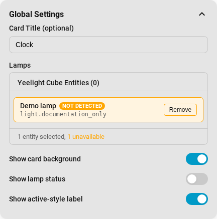<br>Global Settings</td>
    <td valign="top"><br>Preview Appearance</td>
    <td valign="top"><br>Lamp Preview</td>
  </tr>
  <tr>
    <td valign="top"><br>Actions</td>
    <td valign="top"><br>Sliders</td>
    <td valign="top"><br>Content &amp; Controls</td>
  </tr>
  <tr>
    <td valign="top"><br>Custom clock styles and colors</td>
    <td valign="top"><br>Previews</td>
    <td valign="top"><br>Favourites</td>
  </tr>
  <tr>
    <td valign="top"><br>Clock Mode Rotation</td>
  </tr>
</table>
<!-- card-docs:clock:editors:end -->

</details>

<details>
<summary>YAML example</summary>

```yaml
type: custom:yeelight-cube-clock-card
entity: light.cubelite_a904
title: Clock
show_current_preview: true
show_brightness: true
show_animation_speed: true
slider_style: capsule
show_color_modes: true
show_gallery: true
style_selector_style: original
effect_view: grid
items_per_page: 4
show_favourites: true
show_rotation: true
rotation_interval: 30   # seconds; used until the lamp has its own interval
```

</details>

Several lamps, favourites and rotation work as on the Native Effects Card
([below](#native-effects-card)).

---

<a id="native-effects-card"></a>

### Native Effects Card (`custom:yeelight-cube-native-effects-card`)

Browse the lamp's animations with animated previews, pick colors, save
favourites and rotate through them.

<details>
<summary>View card variations</summary>

<!-- card-docs:native-effects:variations:start -->
<table>
  <tr>
    <td valign="top"><br>Square pixels and capsule sliders</td>
    <td valign="top"><br>Dark theme, round pixels and list gallery</td>
    <td valign="top"><br>Rounded pixels and compact text effects</td>
  </tr>
  <tr>
    <td valign="top"><br>Narrow dashboard column</td>
    <td valign="top"><br>Local previews while the lamp is unavailable</td>
    <td valign="top"><br>Card title, lamp status and no card background</td>
  </tr>
  <tr>
    <td valign="top"><br>On a Cube Matrix of six modules: previews as wide as its modules</td>
  </tr>
</table>
<!-- card-docs:native-effects:variations:end -->

</details>

**Features:**

| Feature | Description |
| :-- | :-- |
| **Live previews** | Animated previews of every effect, with your choice of pixel look and size |
| **Effect browser** | Search and browse effects as text buttons or live previews (list, grid, carousel…), with a **family filter** (Waves, Glow, Sparkles, Motion, Music, Still) and each effect's family icon. The editor picks, orders and renames the effects ([all options](SERVICES.md#clock-and-native-effects-cards)) |
| **Color modes** | Supported palettes or custom RGB; favourites remember the colors |
| **Sliders** | Brightness, speed and intensity in several slider styles; speed and intensity show only when the effect uses them |
| **Orientation & actions** | Device orientation, previous, next, random, freeze, refresh and power |
| **Favourites & rotation** | Effect-and-color favourites, rotated on the lamp at your interval |
| **Multiple lamps & offline editing** | Control several lamps; previews still work while a lamp is unavailable |

<details>
<summary>View editor sections</summary>

<!-- card-docs:native-effects:editors:start -->
<table>
  <tr>
    <td valign="top">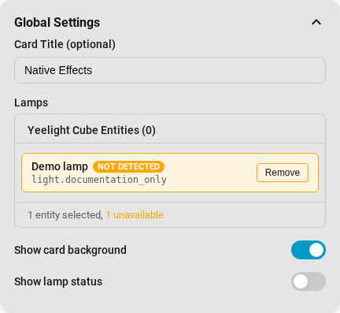<br>Global Settings</td>
    <td valign="top"><br>Preview Appearance</td>
    <td valign="top">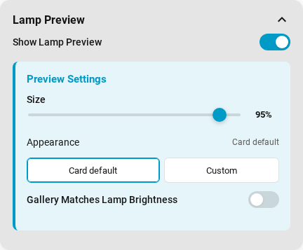<br>Lamp Preview</td>
  </tr>
  <tr>
    <td valign="top"><br>Actions</td>
    <td valign="top"><br>Sliders</td>
    <td valign="top"><br>Device Orientation</td>
  </tr>
  <tr>
    <td valign="top"><br>Color Modes &amp; Controls</td>
    <td valign="top"><br>Custom colors</td>
    <td valign="top"><br>Previews</td>
  </tr>
  <tr>
    <td valign="top"><br>Favourites</td>
    <td valign="top"><br>Effect Rotation</td>
  </tr>
</table>
<!-- card-docs:native-effects:editors:end -->

</details>

<details>
<summary>YAML example</summary>

```yaml
type: custom:yeelight-cube-native-effects-card
entity: light.cubelite_a904
title: Native Effects
show_preview: true
show_brightness: true
show_animation_speed: true
slider_style: capsule
show_color_modes: true
show_gallery: true
style_selector_style: original
effect_view: grid
items_per_page: 4
show_favourites: true
show_rotation: true
rotation_interval: 30   # seconds; used until the lamp has its own interval
```

</details>

**Both cards:** favourites (a style or effect with its colors) are saved in
Home Assistant, so every dashboard and device shows the same ones. A rotation
needs two favourites or more, runs in Home Assistant and resumes after a
restart. For several lamps, list them in `target_entities`; a card keeps
controlling the available ones and names the others.

In detail: [card options, favourites, rotation, sliders and offline use](SERVICES.md#clock-and-native-effects-cards),
[service calls](SERVICES.md#-clock-native-effects-and-rotation).

---

<a id="preview-card"></a>

### 🖥️ Preview Card (`custom:yeelight-cube-lamp-preview-card`)

Shows what the lamp shows, live, with brightness, power, refresh and color adjustments.

<details>
<summary>View card variations</summary>

<!-- card-docs:lamp-preview:variations:start -->
<table>
  <tr>
    <td valign="top"><br>Light theme with brightness and color adjustments</td>
    <td valign="top"><br>Dark theme with round pixels</td>
    <td valign="top"><br>Card title, lamp status and no card background</td>
  </tr>
  <tr>
    <td valign="top"><br>Cube Matrix of six modules (Matrix, Panel, Spot) with its Modules section open</td>
  </tr>
</table>
<!-- card-docs:lamp-preview:variations:end -->

</details>

<details>
<summary>More layout examples</summary>

<table>
  <tr>
    <td></td>
    <td></td>
    <td></td>
    <td></td>
    <td>
    </td>
  </tr>
</table>

</details>

**Features:**

| Feature | Description |
| :-- | :-- |
| **Lamp preview** | What the lamp shows, with your choice of pixel look and size |
| **Refresh & power** | Quick buttons to force-refresh or toggle power |
| **Device orientation** | Right / Down / Left / Up; the preview turns with the lamp |
| **Cube Matrix modules** | Cube Matrix only: the **Modules** button sets which modules the lamp has (see below) |
| **Brightness slider** | Configurable slider styles |
| **Color adjustments** | Hue, temperature, saturation, contrast… with change markers and resets, in several layouts |

<a id="matrix-modules"></a>

**Cube Matrix modules.** On a Cube Matrix, the **Modules** button in the
Actions row opens a section that sets which modules the lamp has, like the
Yeelight app's module page. Add a Matrix, Panel or Spot at the end of the chain
(up to 8) or remove one with its ✕, then **Save** (sent with
[`set_matrix_modules`](SERVICES.md#set_matrix_modules), over Matter) or
**Reset**. The **Device Orientation** row sets the power supply's side. What the
lamp shows is redrawn for the new modules at once. The lamp can't detect its
modules: one missing from the list stays dark, except for a green light in its
corner.

<details>
<summary>View editor sections</summary>

<!-- card-docs:lamp-preview:editors:start -->
<table>
  <tr>
    <td valign="top">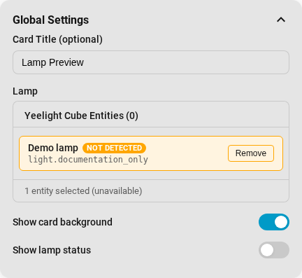<br>Global Settings</td>
    <td valign="top"><br>Preview Appearance</td>
    <td valign="top"><br>Lamp Preview</td>
  </tr>
  <tr>
    <td valign="top"><br>Actions</td>
    <td valign="top">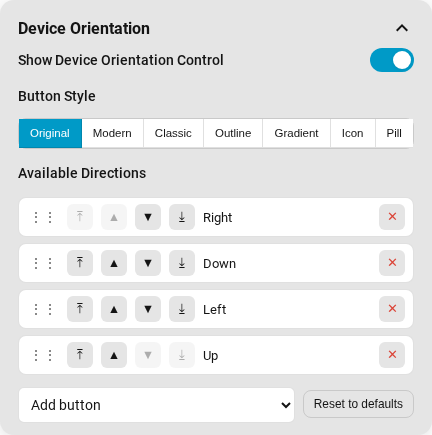<br>Device Orientation</td>
    <td valign="top"><br>Brightness Settings</td>
  </tr>
  <tr>
    <td valign="top"><br>Color Adjustments</td>
  </tr>
</table>
<!-- card-docs:lamp-preview:editors:end -->

</details>

---

<a id="colors-card"></a>

### 🎨 Colors Card (`custom:yeelight-cube-color-list-editor-card`)

Edit the colors the lamp's text uses: add, delete, drag to reorder, shuffle, or save them as a palette.

<details>
<summary>View card variations</summary>

<!-- card-docs:color-list-editor:variations:start -->
<table>
  <tr>
    <td valign="top"><br>Cards with hex codes, drag to reorder</td>
    <td valign="top"><br>Tiles with the add / shuffle / save actions</td>
    <td valign="top">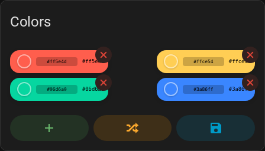<br>Dark theme: compact chips</td>
  </tr>
</table>
<!-- card-docs:color-list-editor:variations:end -->

</details>

**Features:**

| Feature | Description |
| :-- | :-- |
| **Multi-entity support** | Control multiple lamps at the same time |
| **Color list** | Add, remove and drag to reorder, in six layouts (Cards, Tiles, Rows, Grid, Compact, Chips), with optional hex codes or names |
| **Shared look** | **Size** and **Item Radius**, as in the other cards' galleries |
| **Color edit** | Color picker or hex input |
| **Actions** | Add, shuffle, and save as reusable palette |

<details>
<summary>View editor sections</summary>

<!-- card-docs:color-list-editor:editors:start -->
<table>
  <tr>
    <td valign="top">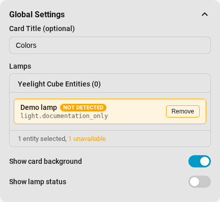<br>Global Settings</td>
    <td valign="top"><br>Color List Settings</td>
    <td valign="top">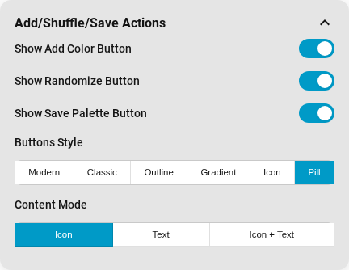<br>Add/Shuffle/Save Actions</td>
  </tr>
</table>
<!-- card-docs:color-list-editor:editors:end -->

</details>

---

<a id="palettes-card"></a>

### 🎭 Palettes Card (`custom:yeelight-cube-palette-card`)

Your color palettes: apply one with a click, rename, delete, reorder, import and export.

<details>
<summary>View card variations</summary>

<!-- card-docs:palette:variations:start -->
<table>
  <tr>
    <td valign="top"><br>Album of palettes with gradient backgrounds</td>
    <td valign="top"><br>List with color swatches and their count</td>
    <td valign="top"><br>Dark theme: grid with color stripes</td>
  </tr>
</table>
<!-- card-docs:palette:variations:end -->

</details>

**Features:**

| Feature | Description |
| :-- | :-- |
| **Multi-entity support** | Control multiple lamps at the same time |
| **Browse & apply** | Browse palettes as previews (list, grid, carousel, album…) or buttons, with many swatch styles and optional search; a click applies one, and the palette the lamps show is highlighted |
| **Manage** | Rename and delete from the gallery (a delete asks first) |
| **Arrange** | Reorder in the card editor (drag or ▲ ▼); the order is shared by every card and the **Matrix: Palette** select |
| **Import/Export** | Load and save full palette collections |

<details>
<summary>View editor sections</summary>

<!-- card-docs:palette:editors:start -->
<table>
  <tr>
    <td valign="top">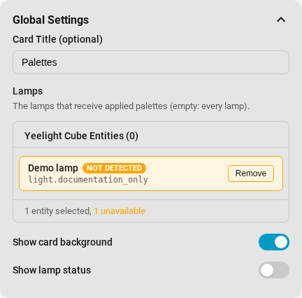<br>Global Settings</td>
    <td valign="top"><br>Palettes</td>
    <td valign="top">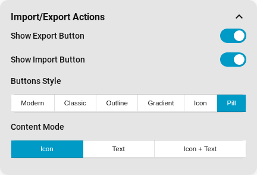<br>Import/Export Actions</td>
  </tr>
</table>
<!-- card-docs:palette:editors:end -->

</details>

---

<a id="gradient-card"></a>

### 🌈 Gradient Card (`custom:yeelight-cube-gradient-card`)

Pick a gradient or color mode, with live previews of each, and set its angle.

<details>
<summary>View card variations</summary>

<!-- card-docs:gradient:variations:start -->
<table>
  <tr>
    <td valign="top"><br>Mode buttons, active mode and a rectangle angle control</td>
    <td valign="top"><br>Chips with live gradient swatches and a compass</td>
    <td valign="top">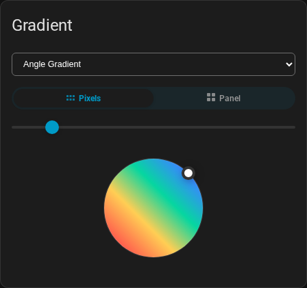<br>Dark theme: dropdown, wheel and panel tabs</td>
  </tr>
</table>
<!-- card-docs:gradient:variations:end -->

</details>

**Features:**

| Feature | Description |
| :-- | :-- |
| **Multi-entity support** | Control multiple lamps at the same time |
| **Unified mode selector** | Every mode as a text button or a live preview with your text, colors and angle (list, grid, carousel…); click to apply. The editor picks, orders and renames them |
| **Shared appearance axes** | **Shape** and **Size**, as on the other cards |
| **Selection feedback** | The chosen mode pulses until the lamp confirms it |
| **Active mode label** | Optional chip naming the active mode |
| **Apply to whole panel** | Apply the gradient to the whole panel instead of the text only |
| **Angle selector** | A bar, wheel, compass, mini matrix or slider, with optional snapping (N, NE, E…) and the angle as text or a number |

> **From an older version?** The "Color Mode Selector" and "Gradient Preview" sections are now one **Mode Selector**; your settings move over by themselves. Text styles are the lightest.

<details>
<summary>View editor sections</summary>

<!-- card-docs:gradient:editors:start -->
<table>
  <tr>
    <td valign="top">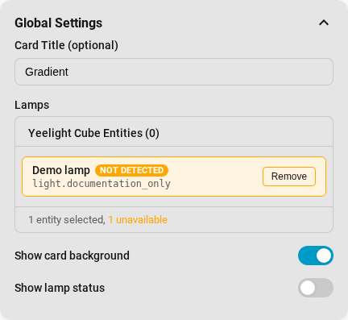<br>Global Settings</td>
    <td valign="top"><br>Preview Appearance</td>
    <td valign="top"><br>Active Mode Label</td>
  </tr>
  <tr>
    <td valign="top"><br>Mode Selector</td>
    <td valign="top">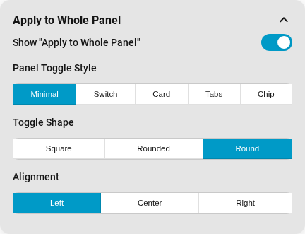<br>Apply to Whole Panel</td>
    <td valign="top"><br>Angle Selector</td>
  </tr>
</table>
<!-- card-docs:gradient:editors:end -->

**Preview Appearance** is the shared matrix look, see
[Shared Preview Appearance](SERVICES.md#shared-preview-appearance).

</details>

---

<a id="draw-card"></a>

### ✏️ Draw Card (`custom:yeelight-cube-draw-card`)

The pixel art editor: draw, save to your gallery, and send to one or more lamps in a tap.

<details>
<summary>View card variations</summary>

<!-- card-docs:draw:variations:start -->
<table>
  <tr>
    <td valign="top"><br>Colors, tools, a drawing and the pixel-art carousel</td>
    <td valign="top"><br>Pixel-art grid: the art being drawn is highlighted</td>
    <td valign="top"><br>Dark theme: round pixels and pixel-art chips</td>
  </tr>
</table>
<!-- card-docs:draw:variations:end -->

</details>

**Features:**

| Feature | Description |
| :-- | :-- |
| **Multi-entity support** | Control multiple lamps at the same time |
| **Colors section** | Recent, palette, current and drawing colors at hand |
| **Drawing tools** | Individually toggleable with multiple styles |
| **Drawing matrix** | The lamp's matrix, lying flat or standing up (Rotate tool) |
| **Action buttons** | Apply to lamp, upload from image, save, or clear |
| **Pixel art gallery** | Your pixel arts as previews (grid, list, carousel…) or buttons, with optional search; a click loads one (and sends it with *Apply to lamp automatically*). Rename, delete and reorder them |
| **Official pixel arts** | The 68 official drawings beside yours, in groups (as tabs or another layout); choose which ones show, and filter flat / standing |
| **Import/Export** | Import and export collections as JSON |

<details>
<summary>View editor sections</summary>

<!-- card-docs:draw:editors:start -->
<table>
  <tr>
    <td valign="top">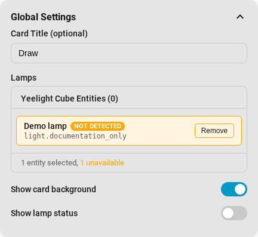<br>Global Settings</td>
    <td valign="top"><br>Layout</td>
    <td valign="top"><br>Colors Section</td>
  </tr>
  <tr>
    <td valign="top"><br>Drawing Tools</td>
    <td valign="top"><br>Preview Appearance</td>
    <td valign="top"><br>Drawing Matrix Section</td>
  </tr>
  <tr>
    <td valign="top"><br>Action Buttons</td>
    <td valign="top"><br>Pixel Art Section</td>
    <td valign="top"><br>Import/Export Actions</td>
  </tr>
</table>
<!-- card-docs:draw:editors:end -->

A **Preview Appearance** section (the shared matrix look, see
[Shared Preview Appearance](SERVICES.md#shared-preview-appearance)) sits
between Drawing Tools and Drawing Matrix Section.

</details>

---

<a id="matrix-preview-cameras"></a>

### Matrix Preview Cameras (Picture Entity card)

Each lamp has two camera entities, **Matrix Preview (Round)** and **Matrix
Preview (Square)**: a picture of what the lamp shows, for a quick preview
with Home Assistant's own **Picture Entity** card (or a picture-glance card,
a notification, another app). For an interactive preview with controls and
the same look as the other cards, use the [Preview Card](#preview-card).

- **What it shows:** the lamp as you see it, right way up, with the clock,
  effects and Music Flow simulated as on the cards.
- **How it looks:** a sharp picture of the lamp in a black frame, on a
  transparent background.
- **Cost:** it is drawn only when someone looks at it.
- **How fast it moves:** with `camera_view: live`, up to 25 frames a second for
  Fireworks (smaller picture) and about 3 for the other effects; with `auto`,
  one picture every 10 seconds. For smooth animation, use the
  [Preview Card](#preview-card).

```yaml
type: picture-entity
entity: camera.living_room_cube_matrix_preview_round
camera_view: live
show_name: false
show_state: false
```

<details>
<summary>Camera orientation, sizing and layout examples</summary>

#### A lamp standing on its end

Turn on the lamp's **Camera Follows Orientation** switch (off by default):
while **Device Orientation** is Down or Up, the cameras draw the lamp standing
up.

#### Size and fit

A picture card is as wide as its place in the dashboard, and either follows
the image's shape or gets a fixed height. With a fixed height, `fit_mode`
decides how the image fits in:

| Card settings | Lamp lying flat | Lamp standing up |
| :-- | :-- | :-- |
| Natural size: `grid_options: rows: auto` (no `aspect_ratio`) | Fits the width ✓ | Very tall in a wide card: give it a narrow one (`columns: 3`) ✓ |
| Fixed height (`grid_options: rows: 3`, or `aspect_ratio: "2:1"` outside sections) and `fit_mode: contain` | Fits the width, room above and below ✓ | Fits the height, room on the sides ✓ |
| Fixed height and `fit_mode: cover` | Sides cropped ✗ | Only the middle rows, zoomed ✗ |
| Fixed height and `fit_mode: fill` | Stretched ✗ | Stretched ✗ |

**For a lamp you turn between orientations**, one card works for both: a
fixed height with `fit_mode: contain`. Three rows is a good balance (about
190 px: a full-width flat lamp, a standing one about 190 px tall); more rows
make the standing lamp larger and leave more room around the flat one.

```yaml
type: picture-entity
entity: camera.living_room_cube_matrix_preview_round
camera_view: auto
fit_mode: contain
show_name: false
show_state: false
grid_options:
  columns: 12
  rows: 3
```

**For the best size in each orientation**, use two cards that show by the
lamp's orientation, each at the image's natural size:

```yaml
# Lying flat (Right / Left): full width
type: conditional
conditions:
  - condition: state
    entity: select.living_room_cube_device_orientation
    state_not: [Up, Down]
card:
  type: picture-entity
  entity: camera.living_room_cube_matrix_preview_round
  camera_view: auto
  show_name: false
  show_state: false
grid_options:
  columns: 12
  rows: auto
---
# Standing up (Up / Down): a narrow card
type: conditional
conditions:
  - condition: state
    entity: select.living_room_cube_device_orientation
    state: [Up, Down]
card:
  type: picture-entity
  entity: camera.living_room_cube_matrix_preview_round
  camera_view: auto
  show_name: false
  show_state: false
grid_options:
  columns: 3
  rows: auto
```

</details>

<details>
<summary>View the camera's fits</summary>

<!-- card-docs:camera:variations:start -->
<table>
  <tr>
    <td valign="top"><br>Lying flat: natural size (rows: auto)</td>
    <td valign="top"><br>Lying flat: fixed height, fit_mode: contain</td>
    <td valign="top"><br>Standing up: fixed height, fit_mode: contain</td>
  </tr>
  <tr>
    <td valign="top"><br>Standing up: natural size in a narrow card (columns: 3)</td>
    <td valign="top"><br>Lying flat: fit_mode: cover (crops the sides)</td>
    <td valign="top"><br>Standing up: fit_mode: cover (crops to the middle)</td>
  </tr>
  <tr>
    <td valign="top"><br>Lying flat: fit_mode: fill (stretches)</td>
    <td valign="top"><br>Standing up: fit_mode: fill (stretches)</td>
    <td valign="top"><br>The Square camera (square pixels)</td>
  </tr>
  <tr>
    <td valign="top"><br>Cube Matrix of six modules: its Matrix, Panel and Spot faces</td>
  </tr>
</table>
<!-- card-docs:camera:variations:end -->

</details>

---

<a id="matrix-modules-card"></a>

### 🧩 Cube Matrix Modules Card (`custom:yeelight-cube-matrix-modules-card`)

Kept for the dashboards that already have it; it is no longer in the card picker. A Cube Matrix's modules are set
from the [Preview card's Modules section](#matrix-modules), which this card shows for each of its
`target_entities` (with its own power supply arrows, saved with the modules).

---

## Entities Created

Each lamp creates its own set of per-device entities, plus the integration creates **global entities** (palettes, drawings, fonts, clock color presets) shared across all lamps.

> [!NOTE]
> The names below are the entity names shown on the device page. Matrix-only
> controls carry a `Matrix:` prefix and clock options a `Clock:` prefix so they
> group together. Entity IDs are derived from the lamp name, e.g.
> `select.cubelite_a904_matrix_display_mode`.

### Per-device Entities

<details>
<summary>View entity screenshots</summary>

<table>
  <tr>
    <td></td>
    <td></td>
    <td></td>
    <td></td>
  </tr>
</table>

</details>

<details>
<summary>All per-device controls, settings and diagnostics</summary>

#### Controls

| Entity | Type | Description |
| :-- | :-- | :-- |
| **Auto Turn On** | Switch | Turn the lamp on when a mode, drawing, text or color is applied while it is off (off: shown at the next turn-on) |
| **(the lamp's name)** | Light | Main light entity, named after the lamp (on/off and brightness; RGB color in Matrix mode) |
| **Content mode** | Select | Switch between Matrix, built-in Clock, Native Effect, and Music Flow |
| **Matrix: Display Mode** | Select | Choose the Matrix render mode (see [Display Modes](#display-modes)) |
| **Matrix: Display Text** | Text | Text shown by the Matrix text modes (at most 255 characters) |
| **Matrix: Font** | Select | Basic, Fat, Italic, or Native (Basic with the built-in clock's digit shapes) |
| **Matrix: Text Alignment** | Select | Text alignment: left, center, right |
| **Matrix: Gradient Angle** | Number | Angle for angle-based gradient modes (0°–360°) |
| **Matrix: Palette** | Select | Apply one of the saved color palettes |
| **Matrix: Pixel Art** | Select | Personal drawings followed by the 68 locally bundled, read-only official presets |
| **Clock: Style** | Select | One of the 73 native clock styles: the lamp's 10 and the experimental ones |
| **Native effect** | Select | One of the 71 animations, experimental ones included (plus four uploaded animations, with a Matter server that sends Yeelight commands) |
| **Effect speed** | Number | Speed of the clock's background and of effects that have one (0–255) |
| **Effect intensity** | Number | How busy an effect is: how many glows or meteors, how often stars appear, a wave's size… (0–255, default 128; one value for all effects) |
| **Music Flow effect** | Select | Gather, Breathing, Blossom, Spectrum, Music Note, or Impact |
| **Clock: Content** | Select | What the clock shows: Time, Time & Date (alternating), or Date |
| **Device Orientation** | Select | How the lamp is mounted: Right / Down / Left / Up (it never changes an effect's direction) |

#### Sensors

| Entity | Type | Description |
| :-- | :-- | :-- |
| **Matrix Preview (Round)** | Camera | Local matrix preview with round pixels; Music Flow uses a static effect illustration |
| **Matrix Preview (Square)** | Camera | Local matrix preview with square pixels; Music Flow uses a static effect illustration |
| **Estimated power** | Sensor | Estimated power draw of the lamp in W. See [Power Supply](#power-supply) |
| **Estimated energy** | Sensor | Estimated energy used by the lamp in kWh, for the Energy dashboard. See [Power Supply](#power-supply) |
| **Lamp buttons** | Event | The lamp's button presses and app changes, as events for automations. Needs [Matter](#matter-optional) |

> [!TIP]
> Use these camera entities with a "Picture Entity" card for quick previews: see [Matrix Preview Cameras](#matrix-preview-cameras) for the card settings that fit a lamp lying flat or standing up. For more responsive previews, use the custom [Preview Card](#preview-card).

#### Configuration

| Entity | Type | Description |
| :-- | :-- | :-- |
| **Camera Follows Orientation** | Switch | Draw the cameras standing up while the lamp stands on its end. Off by default |
| **Clock: Show date** | Switch | Shortcut for Time & Date (alternate time with the date); stays in sync with Clock: Content |
| **Clock: 12-hour format** | Switch | Use 12-hour time instead of 24-hour time |
| **Clock: Blink colon** | Switch | Blink the time separator in Clock mode |
| **Native effect: Direction** | Select | Direction for effects that support movement (Up / Down / Left / Right; Hacking offers Up / Down only) |
| **Native effect: Animation layout** | Select | How the four animations are sent: **Upright** or **As the Yeelight app** |
| **Power-on behavior** | Select | After a power cut: **Restore**, **Always on** or **Always off** |
| **Text scroll** | Switch | Enable scrolling for text wider than the matrix |
| **Text scroll: Interval** | Number | Delay between scroll steps (0.05–2 seconds) |
| **Color: Hue Shift** | Number | Shift colors around the wheel (−180° to +180°) |
| **Color: Temperature** | Number | Warm/cool adjustment (−100 to +100) |
| **Effects: Grayscale** | Number | Grayscale intensity (0–100%) |
| **Effects: Invert** | Number | Color inversion intensity (0–100%) |
| **Effects: Tint Hue** | Number | Tint color hue (0°–360°) |
| **Effects: Tint Strength** | Number | Tint overlay intensity (0–100%) |
| **Intensity: Saturation** | Number | Saturation level (0–200%) |
| **Intensity: Vibrance** | Number | Adaptive saturation (0–200%) |
| **Tone: Contrast** | Number | Contrast level (0–200%) |
| **Tone: Glow** | Number | Bloom / glow effect (0–100%) |
| **Power limit** | Number | Dim bright pictures to keep the lamp under this many watts (7 W = off). See [Power Supply](#power-supply) |
| **Stream frame rate limit** | Number | Cube Lite: pictures a second for what Home Assistant streams to it (1–25, default 2). Above 5 is smoother but a Cube Lite is much more likely to stop answering. [Details](docs/STREAMING.md) |
| **Buttons: Right as Remote** | Switch | Off by default. A right-button press fires `right_button` and brings your display back. Needs Matter settings. [Details](docs/MATTER.md#buttons-as-remote) |
| **Buttons: Left as Remote** | Switch | Off by default. Undoes music started by the left button (or an app) and brings your display back. Needs Matter. [Details](docs/MATTER.md#buttons-as-remote) |
| **Buttons: Wake Lamp When Off** | Switch | On by default. Whether a button press turns an off lamp on. [Details](docs/MATTER.md#buttons-as-remote) |
| **Skip Unchanged Stream Frames** | Switch | Cube Lite, off by default. Send no frame while the streamed picture doesn't change. [Details](docs/STREAMING.md) |
| **Keep Streaming When Off** | Switch | Cube Lite, off by default. Turning off a streamed effect sends black frames instead of stopping the stream, so the lamp never goes silent. [Details](docs/STREAMING.md) |

#### Diagnostic

| Entity | Type | Description |
| :-- | :-- | :-- |
| **Force Refresh** | Button | Re-activate connection for a stuck lamp |
| **IP Address** | Sensor | Current IP address (updated after rediscovery) |
| **Matter link** | Sensor | Not linked, Linked (read only), or Linked, settings available. See [Matter](#matter-optional) |
| **Power cycle** | Binary sensor | **Needed** while the lamp must be unplugged and plugged back in (see its Repair), else **Not needed** |


</details>

### Global Entities

These sensor entities are created **once per integration install** and shared across all lamps.

> [!NOTE]
> A fresh install gets `sensor.saved_drawings`, `sensor.color_palettes`,
> `sensor.font_characters` and `sensor.clock_color_presets`; older installs may
> still have `sensor.yeelight_cube_…` IDs. The cards find these sensors on
> their own, so you can rename them.

<details>
<summary>View global entities details</summary>

<table>
  <tr>
    <td></td>
  </tr>
</table>

#### Saved Drawings (`sensor.saved_drawings`)

Stores all pixel art designs created with the Draw Card.

| Attribute | Type | Description |
| :-- | :-- | :-- |
| `pixel_arts` | list | Ordered list of saved pixel arts (each has `name` + `pixels`) |
| `count` | integer | Number of saved pixel arts |
| `content_hash` | string | MD5 hash; changes on every modification |

**State:** `"N drawings"` (e.g. `"3 drawings"`)

**How to use:** The index in `pixel_arts` corresponds to the index passed to `apply_pixel_art`, `remove_pixel_art`, etc. (0-based):

```yaml
# In Developer Tools → Template
{{ state_attr('sensor.saved_drawings', 'pixel_arts')
   | map(attribute='name') | list }}
# → ['Magic Lamp', 'Bat', 'Whale']
# 'Magic Lamp' = index 0, 'Bat' = index 1, 'Whale' = index 2
```

---

#### Color Palettes (`sensor.color_palettes`)

Stores all saved color palettes.

| Attribute | Type | Description |
| :-- | :-- | :-- |
| `palettes_v2` | list | Ordered list of palettes (each has `name` + `colors`) |
| `count` | integer | Number of saved palettes |
| `content_hash` | string | MD5 hash; changes on every modification |

**State:** `"N palettes"` (e.g. `"3 palettes"`)

---

#### Font Characters (`sensor.font_characters`)

Read-only bitmap font maps used for text rendering.

| Attribute | Type | Description |
| :-- | :-- | :-- |
| `font_maps` | object | Dictionary with keys `"basic"`, `"fat"`, `"italic"` and `"native"` mapping characters to pixel bitmaps |
| `font_metrics` | object | Per-font spacing metrics (currently `"native"`: monospace advance and narrow-glyph overrides) used by the clock previews |

**State:** always `"ready"` - content is static and never changes at runtime.

---

#### Clock Color Presets (`sensor.clock_color_presets`)

Stores the shared library of saved clock styles and reusable color modes
managed by the Clock and Native Effects cards (see
[`save_clock_preset`](SERVICES.md#save_clock_preset--delete_clock_preset)).

| Attribute | Type | Description |
| :-- | :-- | :-- |
| `clock_presets` | list | Saved presets (each has `id`, `name`, `color` and `kind` = `style` or `color_mode`); at most 100 |

**State:** numeric count (e.g. `2`)

</details>

---

## Automations & Node-RED

All entities (light, selectors, sliders, text, switches) can be used in standard automations, scripts, and Node-RED flows. The integration also registers **custom actions (services)** under the `yeelight_cube` domain.

### Quick Reference

Every action, with its fields and examples, is documented in
[SERVICES.md](SERVICES.md). The most used ones:

- **Display:** [`set_custom_text`](SERVICES.md#set_custom_text),
  [`set_mode`](SERVICES.md#set_mode),
  [`set_solid_color`](SERVICES.md#set_solid_color),
  [`set_angle`](SERVICES.md#set_angle),
  [`set_brightness`](SERVICES.md#set_brightness)
- **Pixel art:** [`apply_custom_pixels`](SERVICES.md#apply_custom_pixels),
  [`apply_pixel_art`](SERVICES.md#apply_pixel_art),
  [`save_pixel_art`](SERVICES.md#save_pixel_art)
- **Palettes & colors:** [`load_palette`](SERVICES.md#load_palette),
  [`save_palette`](SERVICES.md#save_palette),
  [`set_text_colors`](SERVICES.md#set_text_colors)
- **Clock, effects and rotation:** [`set_native_effect`](SERVICES.md#set_native_effect),
  [`set_clock_style`](SERVICES.md#set_clock_style),
  [`start_effect_rotation`](SERVICES.md#start_effect_rotation)
- **Status displays:** [`save_state`](SERVICES.md#save_state) /
  [`restore_state`](SERVICES.md#restore_state)
- **Lamp buttons:** [`set_button_effects`](SERVICES.md#set_button_effects)
  (the physical button's presets; needs Matter settings)

How to call them from automations, scripts and Node-RED:
[Node-RED Integration](SERVICES.md#-node-red-integration).

### Example Automations

<details>
<summary>🔔 Doorbell: flash text on lamp</summary>

```yaml
automation:
  alias: "Doorbell: flash text on lamp"
  trigger:
    - platform: state
      entity_id: binary_sensor.doorbell
      to: "on"
  action:
    - action: yeelight_cube.set_custom_text
      data:
        entity_id: light.yeelight_cube_192_168_1_139
        text: "DOOR"
    - action: yeelight_cube.set_mode
      data:
        entity_id: light.yeelight_cube_192_168_1_139
        mode: "Text Color Sequence"
```

</details>

<details>
<summary>🔘 Lamp button: toggle the room's light (Matter)</summary>

The **Lamp buttons** event entity's state is the time of its last event: the
automation triggers on any new state and checks the event type. Details and
the other events: [Button events for automations](docs/MATTER.md#button-events-for-automations).

```yaml
automation:
  alias: "Lamp button: toggle the room's light"
  triggers:
    - trigger: state
      entity_id: event.cubelite_lamp_buttons
      not_from: [unavailable, unknown]
  conditions:
    - condition: template
      value_template: "{{ trigger.to_state.attributes.event_type == 'right_button' }}"
  actions:
    - action: light.toggle
      target:
        entity_id: light.living_room
```

</details>

<details>
<summary>🔄 Node-RED: cycle through pixel art designs</summary>

Use an **Inject** node → **Change** node (set `msg.payload.idx`) → **Call Service** node:

- **Domain**: `yeelight_cube`
- **Service**: `apply_pixel_art`
- **Data**: `{"idx": {{payload.idx}}, "entity_id": "light.yeelight_cube_192_168_1_139"}`

</details>

---

## Display Modes

The **Content mode** entity selects the active content source:

| Content mode | Description |
| :-- | :-- |
| **Matrix** | Render text, gradients, palettes, or drawings through the integration |
| **Clock** | Run the lamp's built-in clock |
| **Native Effect** | Run one of the lamp's built-in animations |
| **Music Flow** | Run the lamp's microphone-reactive renderer (see [Music Flow](#music-flow)) |

When Matrix content is active, the **Matrix: Display Mode** entity or Gradient Card selects the renderer:

| Mode | Description |
| :-- | :-- |
| **Solid Color** | Fill the entire matrix with a single color |
| **Letter Gradient** | Horizontal gradient per character |
| **Column Gradient** | Vertical gradient across 20 columns |
| **Row Gradient** | Horizontal gradient across 5 rows |
| **Angle Gradient** | Gradient at a configurable angle |
| **Radial Gradient** | Gradient radiating from center |
| **Letter Vertical Gradient** | Vertical gradient per character |
| **Letter Angle Gradient** | Angled gradient per character |
| **Text Color Sequence** | Each character gets a different color |
| **Panel Color Sequence** | Color sequence across all pixels |
| **Custom Draw** | Pixel art mode (use the Draw Card) |

- **Built-in pixel art:** the 68 official drawings from the Yeelight app
  (Nature and Geometry, flat and standing), read-only, beside your own in the
  **Matrix: Pixel Art** entity and the [Draw Card](#draw-card).
- **Clock:** 73 styles (the lamp's 10 and experimental ones over the other
  effects), with date, 12/24-hour and colon options.
- **Native effects:** the lamp's built-in animations, the integration's own
  streamed effects, and four animations (Snowfall, Daydream, Halloween glow,
  Moonlit clouds) uploaded over Matter. The previews are drawn by Home
  Assistant the way the lamp draws them.
- **Palette color mode:** effects and clock styles in the lamp's palette:
  sent with the effect when the lamp takes all its colors, otherwise streamed
  over the LAN (UDP).

Built-in pixel art, the clock, native effects, the animations, Palette and
Music Flow in detail: [docs/DISPLAY_MODES.md](docs/DISPLAY_MODES.md). Effect
and clock style names: [`set_native_effect`](SERVICES.md#set_native_effect)
and [`set_clock_style`](SERVICES.md#set_clock_style).

<a id="music-flow"></a>

### Music Flow

**Music Flow is controlled through the lamp's entities, not a dedicated card
or the Native Effects Card.** It uses the microphone inside the lamp and
does not require Matter.

1. Open **Settings → Devices & services → Yeelight Cube Lite** and select your lamp.
2. Set **Music Flow effect** to a mode such as **Spectrum**.
3. Set **Content mode** to **Music Flow**, then play sound near the lamp.
4. To stop it, select **Matrix**, **Clock**, or **Native Effect** in **Content mode**.

For dashboard access, add these two select entities to a standard Home
Assistant **Entities card**.

Music Flow is an overlay: stopping it brings back the previous content and the
lamp's previous power state. Its modes, previews and an automation example:
[Music Flow in detail](docs/DISPLAY_MODES.md#music-flow).

---

## Requirements

| Requirement | Details |
| :-- | :-- |
| **Home Assistant** | 2024.12.0 or newer |
| **Hardware** | Yeelight Cube Smart Lamp Lite or Yeelight Cube Matrix, with **LAN Control** on, on the same LAN (a Cube Matrix also shared to Home Assistant's Matter integration for smooth effects: see [Cube Matrix](#cube-matrix)) |
| **Network** | Home Assistant reaches the lamp on **UDP 55444** (its fast connection) and **TCP 55443** (setup, and the fallback). If UDP is blocked, commands go over TCP on their own; the light's `connection` attribute shows which one is in use (`udp` or `tcp`) |
| **Python packages** | `yeelight` (installed automatically by HA); `Pillow` is provided by Home Assistant core |

---

## Supported Devices

- **Yeelight Cube Smart Lamp Lite** (the 20 × 5 matrix lamp, model `cubelite`),
  with **LAN Control** on in the Yeelight app. Several lamps can be set up,
  each as its own device; the cards can drive several at once.
- **Yeelight Cube Matrix** (the original Yeelight Cube, model `CubeMatrix`):
  a base and 1 to 8 modules in any order of Matrix, Panel and Spot (the
  Yeelight app offers 6), set from the Preview card's
  [Modules section](#matrix-modules). Every card, service and preview covers
  the whole chain. Matter is needed for its own effects, clock and smooth
  streaming: see [docs/CUBE_MATRIX.md](docs/CUBE_MATRIX.md).
- Other Yeelight lamps are left to Home Assistant's own **Yeelight**
  integration (this one keeps its discovery away from its own lamps only).

---

## How the State Updates

- **Home Assistant shows what it last sent:** the Cube Lite can't be asked
  for its state. A change shows at once in Home Assistant and goes to the lamp
  right after.
- **Changes made in the Yeelight app or with the buttons:** without Matter,
  Home Assistant doesn't see them; its next change (or **Force Refresh**)
  shows its own content again. With [Matter](#matter-optional), power,
  brightness, effect, music mode and direction are followed, and the buttons
  fire **Lamp buttons** events.
- **Reachability** is checked in the background: the light is unavailable while
  the lamp doesn't answer, and gets its last state back when it returns.
- **Clock:** daylight saving changes reach the lamp's clock on their own.
- **Estimated power and energy** come from what is shown, not from a
  measurement.

---

## Known Limitations

- **Local network only:** Home Assistant and the lamp must reach each other
  (UDP 55444 and TCP 55443); there is no cloud connection.
- **No read-back:** see [How the State Updates](#how-the-state-updates).
- **Brightness right after quick picture changes:** the lamp can briefly show
  an earlier picture again; it settles on the right one by itself.
- **Music Flow** uses the microphone inside the lamp; its preview in the cards
  is a static picture (the lamp sends no frames back).
- **Physical button presets** (`set_button_effects`) need
  [Matter settings](docs/MATTER.md#optional-matter-settings): the lamp
  refuses this write over the local network. They can't be changed while
  **Buttons: Right as Remote** is on.
- **A weak power supply** makes the lamp freeze or drop off the network on
  bright pictures; see [Power Supply](#power-supply).

---

## Use Cases

- **A status display:** show a text or a pixel art from an automation (a
  doorbell, a phone's battery level, a timer), then come back to the previous
  display with `save_state` / `restore_state`.
- **A desk clock:** the lamp's own clock styles, with your colors and favourites,
  rotating on a schedule.
- **Ambient light:** native effects, gradients and palettes, following scenes or
  the time of day.
- **Pixel art:** your own drawings and the official ones, picked from a
  dashboard or an automation.
- **Music:** Music Flow reacts to the sound in the room.

---

## Power Supply

A Cube Lite draws about **0.4 W** dark and up to about **6 W** on a bright,
busy picture (measured on Cube Lites; a Cube Matrix draws more per module).
Brightness and the number of lit pixels matter most, the color little.

**Estimated power.** Each lamp's **Estimated power** sensor estimates what it
draws now, from a model measured on real lamps, whatever it shows (0.4 W off,
0 W out of reach). **Estimated energy** adds it up in kWh for the **Energy
dashboard** (*Individual devices*).

**Weak or shared power supplies.** If the supply can't keep up, the lamp
freezes on a bright picture or drops off the network until it is unplugged.
Quick picture changes make this more likely. In testing, two lamps froze on a
15 W port and worked on 24 W: plan about 12 W of port per lamp.

**Power limit.** On a limited supply, set each lamp's **Power limit** (0.4–7 W;
7 W = no limit): bright pictures are dimmed just enough, colors kept. Two lamps
on a 15 W port run reliably at 5 W each. It covers everything Home Assistant
draws or streams; for effects, clocks and Music Flow the lamp runs itself,
lower the brightness instead.

---

## Troubleshooting

| Problem | Solution |
| :-- | :-- |
| **Cards not showing** | Clear browser cache with `Ctrl+F5` after installing or updating |
| **Device not found** | Check that the lamp is on the same network with **LAN Control** on in the Yeelight app, and check its IP there |
| **Conflicts with Yeelight integration** | None: this integration hides the Yeelight integration's discovery of Cube lamps |
| **Lamp stuck / unresponsive** | Press the **Force Refresh** button entity, or use the refresh button on the Preview card |
| **Lamp freezes on a bright picture or drops off the network** | The power supply is too weak, especially with two lamps on one port. Use a stronger supply or set the **Power limit**. See [Power Supply](#power-supply) |
| **Colors look off** | Color accuracy correction is built-in and applied automatically |
| **Effects move the wrong way** | Set the lamp's orientation in its **Configure** (or save it in the Yeelight app): see [Set the lamp's orientation](#set-the-lamps-orientation-before-judging-effect-directions). Again after a factory reset |
| **Music Flow does not react to sound** | It uses the lamp's own microphone: play sound near the lamp, or try another Music Flow effect |
| **Changing content stops Music Flow** | Expected: any other content ends Music Flow |
| **Music Flow turns off but the old display does not return** | Press **Force Refresh**, or pick Matrix, Clock or Native Effect again |
| **Music Flow preview is not animated** | Expected: the lamp sends no frames back, so the preview is a still picture |
| **A card says "the last change was not applied (…)"** | The lamp refused or failed the change (the reason is shown, and in the log and the `last_command_error` attribute). Try again or press **Force Refresh** |
| **The light's `connection` attribute shows `tcp`** | UDP (port 55444) is blocked between Home Assistant and the lamp. Everything still works over TCP; UDP is retried every 5 minutes |
| **Lamp changed IP** | It is found again by itself (see the **IP Address** sensor). If not, choose **Reconfigure** in the lamp's ⋮ menu (Settings → Devices & services → Yeelight Cube) and enter the new IP |
| **A Repair says a lamp is unreachable, or uses its slower connection** | Shown after 30 minutes without an answer, or 15 minutes on TCP only; it says what to check and goes away by itself |
| **A Repair says a lamp stopped answering** | Only unplugging the lamp and plugging it back in fixes it. Its **Power cycle** sensor shows **Needed** meanwhile, which an automation with a smart plug can use (keep a limit, e.g. one try an hour) |

**Reporting a problem:** attach the lamp's diagnostics to the
[issue](https://github.com/Max-src/yeelight-cube-ha/issues): **Settings →
Devices & services → Yeelight Cube**, the lamp's ⋮ menu, **Download
diagnostics**. Its IP address, identifier, name and text are redacted.

---

## License

MIT - see [LICENSE](LICENSE) for details.

---

## Support

If you find this integration useful, consider supporting development:

[![Buy Me a Coffee][bmac_badge_large]][bmac]

---

**Yeelight Cube - Made with ❤️ for the Home Assistant community**

<!-- Badge references -->
[ha_badge]: https://img.shields.io/badge/Home%20Assistant-Compatible-green
[ha_link]: https://www.home-assistant.io/
[hacs_badge]: https://img.shields.io/badge/HACS-Default-41BDF5
[hacs_link]: https://hacs.xyz/
[release_badge]: https://img.shields.io/github/v/release/Max-src/yeelight-cube-ha
[release]: https://github.com/Max-src/yeelight-cube-ha/releases
[bmac_badge]: https://img.shields.io/badge/Buy%20Me%20a%20Coffee-support-yellow?logo=buy-me-a-coffee&logoColor=white
[bmac_badge_large]: https://img.shields.io/badge/Buy%20Me%20a%20Coffee-support-yellow?logo=buy-me-a-coffee&logoColor=white&style=for-the-badge
[bmac]: https://buymeacoffee.com/max.src
